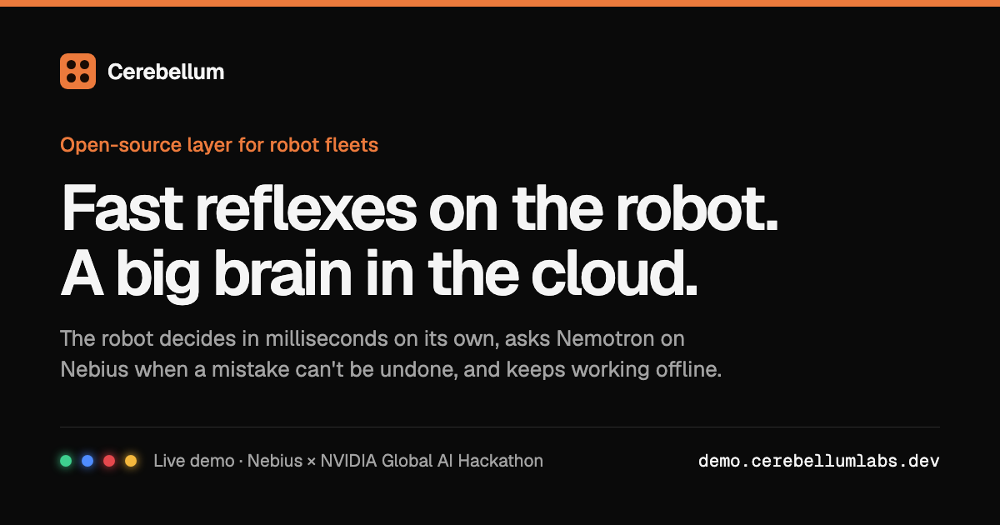

<div align="center">

# Cerebellum

**Fast reflexes on the robot. A big brain in the cloud.**

Open-source layer for robot fleets: each robot decides in milliseconds on its own, asks a cloud vision model when a mistake can't be undone, and keeps working when the Wi-Fi drops.

[](https://demo.cerebellumlabs.dev)
[](https://nebiusglobalaihackathon.devpost.com/)
[](LICENSE)

[](https://demo.cerebellumlabs.dev)

</div>

A robot can't wait a second for a cloud model on every move, and it can't freeze when the Wi-Fi drops. A small model on the robot is fast, but it makes mistakes. Teams end up writing their own glue between the two, and that glue tends to break offline. Cerebellum is the glue, ready-made.

- **Acts in milliseconds.** The robot's own model handles what it's sure of: about 60 ms on a Raspberry Pi in the demo.
- **Asks the cloud when it matters.** The cloud model decides actions that can't be undone and double-checks unsure calls afterwards, correcting the robot when it's wrong.
- **Keeps working offline.** The robot journals every decision and syncs once the network is back.
- **One server for a fleet.** Each robot syncs with its own token. One journal, one dashboard and one cloud bill cover them all.

## Live demo

**[demo.cerebellumlabs.dev](https://demo.cerebellumlabs.dev)** is the real Cerebellum dashboard, connected to a demo robot: a Raspberry Pi with a camera that sorts fruit. Fruit goes in the basket, anything else is thrown out, and a person in view stops it.

- The home page compares Cerebellum with sending every decision to the cloud, on live numbers: time to decide, cost and what happens offline.
- The journal lists every decision with its camera frame. Open one to see who decided and how, the cloud model's raw reply, what it cost and the record straight from the API.

Fruit sorting is just the example: you set the task, its options and how risky each action is.

## Hackathon

Cerebellum is built for the [Nebius x NVIDIA Global AI Hackathon](https://nebiusglobalaihackathon.devpost.com/), **Physical AI** track: robots that see and act in the physical world, with NVIDIA Nemotron on Nebius Token Factory as their cloud brain.

| Part | Built with |
| --- | --- |
| Cloud model | NVIDIA Nemotron 3.5 Super VL on [Nebius Token Factory](https://tokenfactory.nebius.com) |
| Robot | Raspberry Pi with a camera, YOLOX-Nano as the local model |
| Agent | Python, SQLite journal and queue on the robot |
| Server | Go, PostgreSQL, one container behind a Cloudflare Tunnel |
| Dashboard | React, live over WebSocket |

**Status:** a hackathon project in early development. Versions are 0.x, and the agent–server API may still change.

## How it works

```
 robot code ──▶ agent (on the robot) ───HTTPS──▶ server (cloud) ──▶ Nemotron (Nebius Token Factory)
 camera, motors   rules, SQLite journal and queue   journal, review          decides and reviews
 local model      sync in the background            dashboard (live)
```

The robot hands the agent a task, a frame and its local model's answer. The agent routes it by your rules:

| Class | Example | Who decides | Without a network |
| --- | --- | --- | --- |
| Reflex | stop when a person is near | the robot, at once; the agent only journals it | works |
| Reversible | put an item in the basket | the agent, from the local model; the server reviews the uncertain ones later and sends a correction if it disagrees | works |
| Irreversible | throw an item away | only the server, which asks the cloud model | waits in the queue |

The server never calls the robot, so a robot behind NAT or on a phone hotspot works: anything the server has for it comes back in the response to the robot's next request. The robot journals each decision first and syncs it later. The dashboard shows every robot live: where each decision was made, by which model, how sure it was, how fast and at what cost.

**Models.** The cloud model sees the robot's frame and decides from it. It is NVIDIA Nemotron 3.5 Super VL through [Nebius Token Factory](https://tokenfactory.nebius.com) by default; the endpoint and the model are settings of the server. The demo robot's local model is YOLOX-Nano.

## Getting started

1. **Server.** Deploy it with [`infra`](infra) (Docker, PostgreSQL, a Cloudflare Tunnel), or run it locally with `make db run` in [`packages/server`](packages/server). Open the dashboard, sign in and add a robot: the dashboard shows its token once.
2. **Agent.** Python 3.11+ and [uv](https://docs.astral.sh/uv/). Put `CEREBELLUM_URL` and `CEREBELLUM_TOKEN` in the robot's environment and see [`packages/agent`](packages/agent) for the API; the wire format is [`AGENT_API.md`](packages/server/AGENT_API.md).
3. **Try it.** The [fruit sorter](examples/fruit-sorter) simulates the demo's camera and items, so no hardware is needed:

   ```bash
   cd examples/fruit-sorter
   uv sync && cp .env.example .env     # then put the robot's token in .env
   uv run fruit-sorter sim
   ```

   On a Raspberry Pi with a camera, LEDs and a servo, the same code drives the real robot.

## Repository layout

| Path | What |
| --- | --- |
| [`packages/agent`](packages/agent) | Library that runs on the robot |
| [`packages/server`](packages/server) | Cloud server |
| [`packages/dashboard`](packages/dashboard) | Web dashboard |
| [`examples/fruit-sorter`](examples/fruit-sorter) | Demo robot on a Raspberry Pi |
| [`infra`](infra) | Docker compose for the server behind a Cloudflare Tunnel |

## Contributing

See [CONTRIBUTING.md](CONTRIBUTING.md). Releases: [RELEASING.md](RELEASING.md). Security issues: [SECURITY.md](SECURITY.md). Third-party models and their licenses: [THIRD_PARTY_NOTICES.md](THIRD_PARTY_NOTICES.md).

## Acknowledgements

Thanks to Nebius and NVIDIA for the hackathon and Token Factory. YOLOX by Megvii runs on the robot; every third-party model and its license is listed in [THIRD_PARTY_NOTICES.md](THIRD_PARTY_NOTICES.md).

## License

[MIT](LICENSE)
