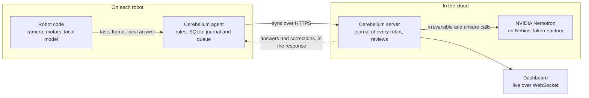

<div align="center">


# Cerebellum

**The open-source decision layer for robot fleets.**

Each robot decides on its own model in milliseconds, NVIDIA Nemotron approves every action that can't be undone, and the fleet keeps working when the network drops.

[](https://demo.cerebellumlabs.dev)
[](https://nebiusglobalaihackathon.devpost.com/)
[](https://github.com/cerebellum-labs/cerebellum/actions/workflows/ci.yml)
[](LICENSE)

</div>

## Why

A robot that sorts, picks or inspects things has two bad options. It can send every frame to a large vision-language model in the cloud: close to a second per decision, a bill for every call, and a robot that stops when the Wi-Fi drops. Or it can trust a small model on the device: fast, but nobody catches its mistakes, including the ones that can't be taken back. Teams end up writing their own glue between the two, and that glue tends to break offline.

Cerebellum is that glue, ready-made. You mark each action by what a mistake would cost, and it routes every decision to the robot's model or to the cloud:

- **Fast.** The robot's own model handles what it's sure of: about 65 ms on a Raspberry Pi in the demo.
- **Safe where it matters.** Only Nemotron decides actions that can't be undone, and it reviews the robot's unsure calls afterwards.
- **Offline-proof.** The robot journals every decision and syncs once the network is back.
- **One server for the fleet.** Each robot syncs with its own token, so one journal, one dashboard and one cloud bill cover them all.

## Live demo

**[demo.cerebellumlabs.dev](https://demo.cerebellumlabs.dev)** is the real dashboard, connected to a demo robot: a Raspberry Pi with a camera that sorts fruit. Fruit goes in the basket, anything else is thrown out, and a person in view stops it. No sign-in is needed to look around.

- The overview compares Cerebellum with sending every decision to the cloud: time to decide, cost and what happens offline.
- The journal lists every decision with its camera frame. Open one to see who decided and how, the cloud model's raw reply and what it cost.

When the demo robot is switched off, the dashboard says so and shows its last run.

## How it works



The robot hands the agent a task, a frame and its local model's answer. The agent routes it by your rules:

| Class | Example | Who decides | Without a network |
| --- | --- | --- | --- |
| Reflex | stop when a person is in view | the robot, at once; the agent only journals it | works |
| Reversible | put an item in the basket | the robot's local model; Nemotron reviews it later if the model was unsure | works |
| Irreversible | throw an item away | only Nemotron, through the server | waits in the queue |

Nemotron never drives the motors: it picks among the options the robot offers. When a review disagrees with the robot, the robot gets a correction on its next sync and fixes the consequences; in the demo, a white light asks the operator to take the item back out.

The server never calls the robot, so a robot behind NAT or on a phone hotspot works: whatever the server has for it comes back in the response to the robot's next request. Every decision lands in the journal with its frame: who decided, with which model, how sure, how fast and at what cost. Video stays on the robot; only single frames go out.

## Quick start

The fastest look needs no setup: the [live demo](https://demo.cerebellumlabs.dev) runs the real dashboard against a real robot.

To run the whole stack on one machine, with a simulated robot instead of hardware, you need:

- Docker, with port 5432 free for PostgreSQL;
- Go 1.27;
- Node.js 24 and pnpm (`corepack enable` sets up the pinned version);
- Python 3.11 or newer and [uv](https://docs.astral.sh/uv/) (`curl -LsSf https://astral.sh/uv/install.sh | sh`).

```bash
git clone https://github.com/cerebellum-labs/cerebellum && cd cerebellum
```

Then use three terminals, each starting at the repository's root:

1. **Server**: PostgreSQL 18 in Docker, and the API on port 8080. The key comes from [Nebius Token Factory](https://tokenfactory.nebius.com).

   ```bash
   cd packages/server
   NEBIUS_API_KEY=<your key> make db run
   ```

   Without a key everything runs except Nemotron: the robot waits on each irreversible decision, its log shows "the server has no cloud model configured", and it gives up after three tries; nothing is reviewed. `make db` leaves the database container running; next time, start the server with `make run`, or remove the database with `docker stop cerebellum-postgres`.

2. **Dashboard** at http://localhost:5173. It passes `/api` through to the server.

   ```bash
   cd packages/dashboard
   pnpm install && pnpm dev
   ```

   Open **Robots**, sign in with the password `admin`, click **Add robot**, give it a name and add it. The dialog then shows two lines for the robot's `.env`, with a token that won't be shown again: **Copy both lines**.

3. **Robot**: the fruit sorter on a simulated camera, with the real agent.

   ```bash
   cd examples/fruit-sorter
   uv sync
   # create .env with the two lines from the dialog
   uv run fruit-sorter sim
   ```

   The simulation runs for about 45 seconds and exits. Watch the **Journal**: an orange goes in the basket on the robot's own model at once; a cup, and a kiwi the detector doesn't know, wait for Nemotron, since throwing an item away can't be undone; a doubtful orange goes in the basket and its review comes later; a hand stops the robot.

To look at the dashboard alone, run `VITE_API_MOCK=true pnpm dev` in `packages/dashboard`: it uses an in-memory mock with no server.

## Add it to a robot

The agent is a Python library the robot code imports. These are the demo robot's real rules:

```python
from cerebellum import Cerebellum

RULES = {
    "tasks": {
        "sort_item": {
            "options": ["basket", "discard"],
            "prompt": (
                "Look at the object in the photo itself: the detector's label can be wrong. Is it a fruit in the "
                "everyday sense, the kind sold in the fruit section of a shop? Vegetables are not fruits. "
                "Answer basket if it is a fruit, discard otherwise."
            ),
        },
    },
    "actions": {
        "basket": {"class": "reversible", "review_below": 0.9},
        "discard": {"class": "irreversible"},
        "stop": {"class": "reflex"},
    },
}

agent = Cerebellum(RULES)  # CEREBELLUM_URL and CEREBELLUM_TOKEN from the environment
agent.on_decision(act)     # the cloud answered
agent.on_correction(fix)   # a review disagreed
agent.start()

agent.decide("sort_item", proposed_action="discard", frame=jpeg_bytes,
             local_model="yolox-nano", local_confidence=0.3)
```

`decide` never blocks. The full API is in [`packages/agent`](packages/agent), and the wire format in [`AGENT_API.md`](packages/server/AGENT_API.md), so a robot in another language can talk to the server too. On a Raspberry Pi with a camera, LEDs and a servo, the same code drives the demo robot: [`examples/fruit-sorter`](examples/fruit-sorter) has the setup (`uv sync --extra pi`, `uv run fruit-sorter download-model`, `uv run fruit-sorter run --pi`) and the wiring.

## NVIDIA Nemotron on Nebius Token Factory

The cloud model is NVIDIA Nemotron 3.5 Super VL, called through Token Factory's OpenAI-compatible API. The server sends the robot's frame as a base64 image, asks for a JSON reply, and uses the model for two jobs:

| Job | Reasoning | Measured |
| --- | --- | --- |
| Decide an irreversible action while the robot waits | off | about 1 s and 40 output tokens |
| Review an unsure decision of the robot in the background | on | about 2 s and 300–500 output tokens |

Reasoning is switched per call through `chat_template_kwargs`; see [`internal/model`](packages/server/internal/model). The endpoint and the model are server settings, so another OpenAI-compatible vision model can take Nemotron's place.

**Where Token Factory sped us up.** We never deployed or served a vision-language model: the Go server reaches Nemotron with a plain HTTP client and one API key. Billing is per token: in the demo a decision costs about $0.0002, and a review, which reasons, two to three times that. The server reads the token usage of every reply, so the dashboard shows what each call cost.

**Other Nebius services.** None: Token Factory is the only Nebius service Cerebellum uses.

## Deploy

- Server: [`infra`](infra) runs it with PostgreSQL in Docker Compose behind a Cloudflare Tunnel, so the host needs no open ports. The image is `ghcr.io/cerebellum-labs/cerebellum-server`, for `linux/amd64` and `linux/arm64`.
- Dashboard: any static host; the demo uses Cloudflare Pages. See [`packages/dashboard`](packages/dashboard) for `VITE_API_URL` and the security headers.
- Robot: the agent keeps its journal and queue in SQLite, so a reboot or a power cut loses nothing. The fruit sorter ships a systemd unit to start at boot.

## Repository layout

| Path | What | Built with |
| --- | --- | --- |
| [`packages/agent`](packages/agent) | Library that runs on the robot | Python, SQLite |
| [`packages/server`](packages/server) | Cloud server: agent API, review, dashboard API | Go, PostgreSQL |
| [`packages/dashboard`](packages/dashboard) | Live web dashboard | React, WebSocket |
| [`examples/fruit-sorter`](examples/fruit-sorter) | Demo robot on a Raspberry Pi | Python, YOLOX-Nano, OpenCV |
| [`infra`](infra) | The server in Docker Compose behind a Cloudflare Tunnel | Docker |

## Hackathon

Cerebellum is built for the [Nebius x NVIDIA Global AI Hackathon](https://nebiusglobalaihackathon.devpost.com/), Physical AI track: an agent runtime on each robot that senses and acts in the physical world, with NVIDIA Nemotron on Nebius Token Factory as its cloud brain.

Status: early development. Versions are 0.x, and the agent–server API may still change.

## Contributing

See [CONTRIBUTING.md](CONTRIBUTING.md). Releases: [RELEASING.md](RELEASING.md). Security issues: [SECURITY.md](SECURITY.md). Third-party models and their licenses: [THIRD_PARTY_NOTICES.md](THIRD_PARTY_NOTICES.md).

Thanks to Nebius and NVIDIA for the hackathon and Token Factory. YOLOX by Megvii runs on the robot.

## License

[MIT](LICENSE)
